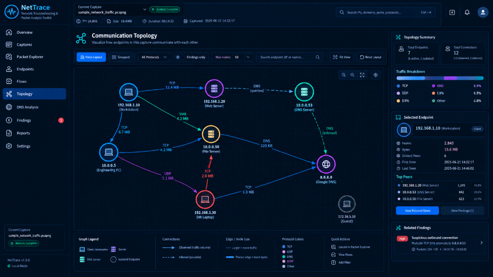
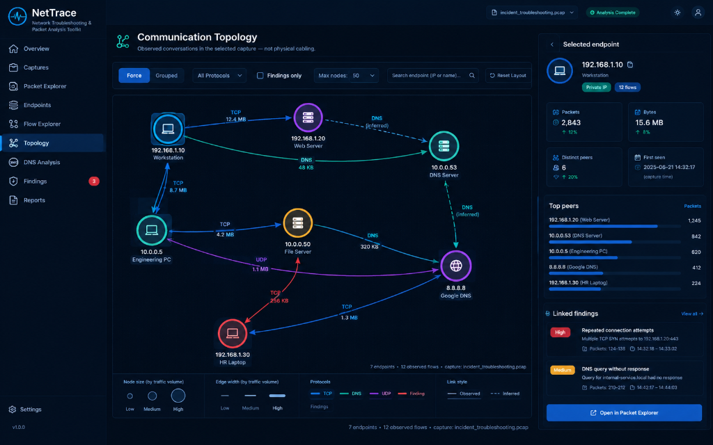

# NetTrace — Offline PCAP/PCAPNG Packet Analysis & Communication Topology Platform

NetTrace is an offline network troubleshooting, packet inspection, and communication topology platform built with **FastAPI**, **Scapy**, **SQLAlchemy (SQLite)**, and **React 18 + TypeScript + Vite**. It parses `.pcap` and `.pcapng` packet captures into frame-level decoded layers, Wireshark-style display-filtered packet streams, correlated L4 flows, DNS transaction diagnostics, and an interactive communication topology graph.

---

## Visual Overview & Running Application Proof

### 1. Interactive Communication Topology (`/topology`)
Renders observed L3/L4 communications and inferred L2 relationships (`inferred_l2`, carrying explicit `inferred=true` and `basis` explanations) with force-directed and 3-column grouped layouts, isolated-endpoint separation, volume-scaled edges, protocol breakdown bars, and evidence-linked findings:



### 2. Endpoint Telemetry & Evidence Correlation
Selecting any node or directional edge surfaces packet/byte counts, distinct peers, first/last seen timestamps, MAC/TTL hop-distance estimates, top peer shares, and 1-click links into Packet Explorer, Flow Explorer, and the Frame Evidence Modal:



---

## Core Capabilities

- **Streaming PCAP/PCAPNG Parser (`backend/app/services/packet_parser.py`):** Validates magic bytes (`\xd4\xc3\xb2\xa1`, `\xa1\xb2\xc3\xd4`, `\x0a\x0d\x0d\x0a`), streams packets via Scapy `PcapReader`, and extracts Frame, Ethernet II, ARP, IPv4/IPv6, TCP/UDP/ICMP, DNS, HTTP, and TLS SNI layers with exact byte offsets (`byte_start`, `byte_end`) and raw hex dumps.
- **Recursive-Descent Display-Filter Engine (`backend/app/services/display_filter.py` & `frontend/src/lib/displayFilter.ts`):**
  - Safe tokenizer + recursive-descent AST parser (zero `eval`/`exec`).
  - Supports logical operators (`&&`/`and`, `||`/`or`, `!`/`not`), parentheses, comparisons (`==`, `!=`, `>`, `>=`, `<`, `<=`, `contains`), protocol existence checks (`tcp`, `udp`, `dns`, `icmp`, `arp`, `http`, `tls`), and field filters (`ip.addr`, `ip.src`, `ip.dst`, `tcp.port`, `udp.port`, `tcp.flags.syn`, `tcp.flags.reset`, `frame.number`, `frame.len`, `dns.qry.name`, `dns.rcode`).
  - Identical semantics in both backend SQLite/Python evaluation and frontend live syntax validation + autocomplete.
- **3-Pane Wireshark-Style Packet Explorer (`/packets`):**
  - Synchronized Packet List, Expandable Protocol Layer Tree, and Hex/ASCII Byte View (clicking a protocol layer or field highlights its exact byte range in the hex dump).
  - Visual Filter Builder, Quick Filter pills, Saved/Recent filters, Previous/Next match navigation, and 2-endpoint Conversation Stream modal.
- **Communication Topology Engine (`backend/app/services/topology_service.py`):**
  - Aggregates observed endpoints, directional flow edges, protocol packet/byte distributions, and inferred L2 gateway/shared-MAC links.
  - Every heuristic role (`dns_server`, `web_service`, `scanner`, `gateway_candidate`) and L2 link explicitly records `inferred: bool` and a human-readable `basis` string.
- **Evidence-Linked Anomaly & Scan Detection (`backend/app/services/scan_detector.py`, `tcp_analyzer.py`, `dns_analyzer.py`):**
  - Detects TCP SYN port scans, host sweeps, connection resets (`RST`), incomplete 3-way handshakes, retransmissions, and DNS `NXDOMAIN` / `SERVFAIL` / unanswered queries.
  - Every finding cites exact supporting packet numbers and timestamps.

---

## Display-Filter Language Reference

| Expression | Meaning |
| :--- | :--- |
| `ip.addr == 192.168.1.10` | Matches packets where either `src_ip` or `dst_ip` is `192.168.1.10` |
| `ip.src == 192.168.1.10 && tcp` | TCP packets sent from `192.168.1.10` |
| `dns \|\| tcp.port == 443` | DNS packets or TCP packets on port 443 |
| `tcp.flags.syn == 1 && tcp.flags.ack == 0` | Initial TCP SYN connection requests |
| `tcp.flags.reset == 1` | TCP packets with the `RST` flag set |
| `frame.number == 100` | Frame #100 |
| `frame.len > 1000` | Frames larger than 1,000 bytes |
| `!(arp)` | All non-ARP packets |

**Documented Differences from Wireshark:**
- NetTrace implements a focused subset of 27 core L2–L7 fields rather than Wireshark's full 300,000-field dissector dictionary.
- Missing field comparisons (e.g., `tcp.port != 80` on a UDP packet) evaluate to `False`, matching Wireshark's strict field-existence semantics (`!(tcp.port == 80)` matches non-TCP packets).
- CIDR subnet notation (`ip.addr == 192.168.1.0/24`) and bitwise flag masks (`tcp.flags & 0x02`) are planned for a future release.

---

## Verified Test Suite & Build Output

Run the full automated verification suite (`pytest` + `vitest` + `tsc && vite build` + deterministic sample PCAP verification):

```powershell
powershell -ExecutionPolicy Bypass -File .\scripts\verify.ps1
```

### Real Output from `.\scripts\verify.ps1`

```text
==========================================
 NetTrace: Full Suite Automated Verification
==========================================

[1/4] Running Backend Automated Tests (Pytest)...
============================= test session starts =============================
platform win32 -- Python 3.11.9, pytest-8.4.2, pluggy-1.7.0
rootdir: backend
configfile: pyproject.toml
testpaths: tests
collecting ... collected 12 items

tests/test_backend.py::test_health_endpoint PASSED                       [  8%]
tests/test_backend.py::test_upload_rejections PASSED                     [ 16%]
tests/test_backend.py::test_upload_normal_capture PASSED                 [ 25%]
tests/test_backend.py::test_upload_incident_capture_and_diagnostics PASSED [ 33%]
tests/test_backend.py::test_topology_normal_sample PASSED                [ 41%]
tests/test_backend.py::test_topology_incident_sample PASSED              [ 50%]
tests/test_backend.py::test_topology_truncation PASSED                   [ 58%]
tests/test_backend.py::test_topology_old_analysis PASSED                 [ 66%]
tests/test_backend.py::test_topology_404 PASSED                          [ 75%]
tests/test_backend.py::test_packets_facets_and_advanced_filters PASSED   [ 83%]
tests/test_backend.py::test_display_filter_engine_parser_precedence_and_validation PASSED [ 91%]
tests/test_backend.py::test_packets_display_filter_api_and_exports PASSED [100%]

======================== 12 passed, 1 warning in 3.71s ========================

[2/4] Running Frontend Automated Tests (Vitest)...
 RUN  v2.1.9 frontend
 ✓ src/tests/App.test.tsx (10 tests) 863ms
 Test Files  1 passed (1)
      Tests  10 passed (10)

[3/4] Running Production Frontend TypeScript & Bundle Build...
> tsc && vite build
✓ 2389 modules transformed.
dist/index.html                   0.62 kB │ gzip:   0.41 kB
dist/assets/index-C343y5Ce.css   43.31 kB │ gzip:   8.19 kB
dist/assets/index-BZ_bLg3y.js   841.80 kB │ gzip: 224.67 kB
✓ built in 8.39s

[4/4] Verifying Deterministic Lab Captures...
>> Sample PCAPs and Manifest Validated!
==========================================
 ALL NETTRACE VERIFICATION CHECKS PASSED!
==========================================
```

---

## Sample Input & Real API Output

### Input Capture
- **File:** [`samples/incident_troubleshooting.pcap`](samples/incident_troubleshooting.pcap) (42 packets, deterministic multi-symptom lab capture generated by [`samples/generate_samples.py`](samples/generate_samples.py))

### Sample Output — Display Filter Query (`GET /api/v1/captures/{id}/packets?display_filter=tcp.flags.reset == 1`)

```json
{
  "total": 6,
  "page": 1,
  "page_size": 2,
  "items": [
    {
      "packet_number": 3,
      "timestamp": 1700000100.06,
      "rel_time": 0.06,
      "src_ip": "10.0.0.80",
      "dst_ip": "192.168.1.105",
      "src_port": 8080,
      "dst_port": 49153,
      "protocol": "TCP",
      "length": 54,
      "tcp_flags": "ACK, RST",
      "info": "8080 → 49153 [ACK, RST] Seq=0 Ack=3001 Win=0 Len=0",
      "details": {
        "ip_ttl": 64,
        "layers_tree": [
          { "name": "Frame 3", "byte_start": 0, "byte_end": 54 },
          { "name": "Ethernet II", "byte_start": 0, "byte_end": 14 },
          { "name": "Internet Protocol Version 4 (IPv4)", "byte_start": 14, "byte_end": 34 },
          { "name": "Transmission Control Protocol (TCP)", "byte_start": 34, "byte_end": 54 }
        ],
        "raw_hex": "ffffffffffff14d4248e4b0f080045000028000100004006ae6e0a000050c0a801691f90c0010000000000000bb950140000f8240000"
      }
    }
  ]
}
```

---

## Implemented & Verified vs. Planned Scope

| Feature Area | Status | Verification Coverage |
| :--- | :--- | :--- |
| Offline `.pcap` / `.pcapng` ingestion & magic-byte validation | **Implemented & Verified** | `test_upload_rejections`, `test_upload_normal_capture` |
| Recursive-descent Display-Filter Engine (AST parser + SQLite/Python evaluator) | **Implemented & Verified** | `test_display_filter_engine_parser_precedence_and_validation` |
| 3-Pane Packet Explorer (Packet table, Layer tree, synchronized Hex/ASCII viewer) | **Implemented & Verified** | `test_packets_display_filter_api_and_exports`, `App.test.tsx` |
| Interactive Communication Topology (Force/Grouped layout, isolated nodes, inferred L2 basis) | **Implemented & Verified** | `test_topology_incident_sample`, `test_topology_truncation`, `App.test.tsx` |
| TCP handshake, reset, retransmission & port-scan detection with packet evidence | **Implemented & Verified** | `test_upload_incident_capture_and_diagnostics` |
| DNS query/response correlation (`NXDOMAIN`, `SERVFAIL`, unanswered queries) | **Implemented & Verified** | `test_upload_incident_capture_and_diagnostics` |
| Multi-format Export (Self-contained HTML, ReportLab PDF, JSON, filtered CSV) | **Implemented & Verified** | `test_packets_display_filter_api_and_exports` |
| Live network interface packet capture (`pcap` promiscuous sniffing) | **Out of Scope (Offline by design)** | Documented in Known Limitations |
| CIDR subnet display filters (`192.168.1.0/24`) & TCP payload stream reassembly | **Planned** | Roadmap |

---

## Quickstart & Installation

### Windows (PowerShell)
```powershell
.\scripts\setup.ps1
.\scripts\start.ps1
```
- **Frontend UI:** `http://127.0.0.1:5173`
- **Backend API & Docs:** `http://127.0.0.1:8000/docs`

### Linux / macOS (Bash)
```bash
chmod +x scripts/*.sh
./scripts/setup.sh
./scripts/start.sh
```

---

## Known Limitations

1. **Offline PCAP/PCAPNG Analysis Only:** NetTrace does not capture live traffic from network interfaces; it analyzes captured `.pcap` and `.pcapng` files offline.
2. **Observation Vantage Point:** Missing responses or inferred TTL hop distances reflect the vantage point of the capture interface and do not prove remote host failure or physical router cabling.
3. **Encrypted Payloads:** TLS/HTTPS and SSH payloads are not decrypted; analysis is based on transport headers, handshake metadata, and SNI/DNS records.
4. **Capture Size:** Optimized for captures up to 100 MB. Split multi-gigabyte captures with `editcap` before uploading.

---

## Author

**Deepak G.**  
B.E. in Computer Science and Engineering — Ballari Institute of Technology & Management (BITM)  
GitHub: [@deepakg710](https://github.com/deepakg710)
