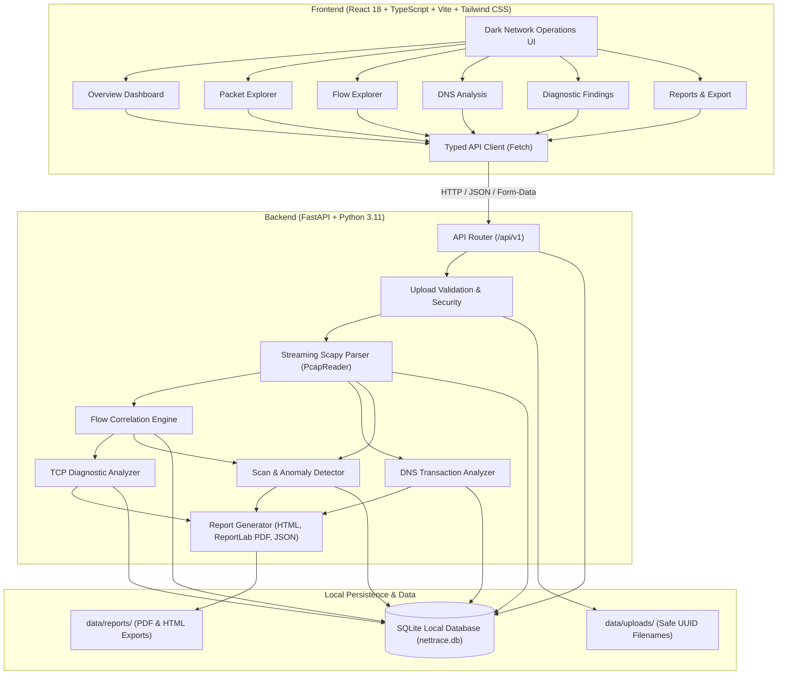

# NetTrace Architecture

## High-Level System Architecture

NetTrace is an offline network troubleshooting and packet analysis application. It couples an asynchronous FastAPI backend powered by Scapy and SQLAlchemy with a React + TypeScript dark network operations dashboard.

## Component Responsibilities

### 1. Ingestion & Security Validation (`app/core/security.py`)
- Restricts uploaded files to `.pcap` and `.pcapng`.
- Inspects magic bytes (`0xa1b2c3d4`, `0xd4c3b2a1`, `0xa1b23c4d`, `0x4d3cb2a1`, `0x0a0d0d0a`).
- Rejects empty captures (< 24 bytes) and oversized uploads (> 100 MB).
- Saves files with non-deterministic UUID stems in `backend/data/uploads` to prevent path traversal.

### 2. Streaming Packet Parser (`app/services/packet_parser.py`)
- Employs Scapy's `PcapReader` to stream packets rather than slurping gigabytes into memory.
- Safely extracts frame metadata: packet index (1-based), float timestamp, wire and captured lengths, network protocols (IPv4, IPv6, ARP), transport layers (TCP, UDP, ICMP), application layers (DNS, HTTP, TLS).
- Individual corrupted frames yield non-fatal warning records, ensuring a single corrupt frame never crashes the pipeline.

### 3. Flow Analyzer (`app/services/flow_analyzer.py`)
- Constructs canonical bidirectional flow keys: `min(ip1:port1, ip2:port2)_max(ip1:port1, ip2:port2)_proto`.
- Distinguishes initiator vs responder and computes directional packet/byte totals.
- Classifies TCP handshake states:
  - `ESTABLISHED`: SYN, SYN-ACK, ACK observed.
  - `INCOMPLETE_HANDSHAKE`: SYN observed without return handshake.
  - `RESET`: RST observed.
  - `CLOSED_CLEAN`: Orderly FIN/ACK exchange observed.
  - `ONGOING_OR_MIDSTREAM`: Mid-connection observation.

### 4. Diagnostic Analyzers
- **TCP Analyzer (`app/services/tcp_analyzer.py`):** Incomplete handshakes, resets, retransmission candidates, repeated connection attempts.
- **DNS Analyzer (`app/services/dns_analyzer.py`):** Query-to-response correlation by `(id, client, server, qname)`, NXDOMAIN, SERVFAIL, unanswered query tracking, latency.
- **Scan & Anomaly Detector (`app/services/scan_detector.py`):** Configurable port scans, host sweeps, connection bursts, rate spikes, and periodic connection candidates.

### 5. Multi-Format Report Generator (`app/services/report_service.py`)
- **HTML Report:** Responsive, self-contained single-page report with dark Tailwind styling and safe HTML escaping.
- **PDF Report:** Multi-page document compiled via ReportLab with tables, finding callouts, and page numbering.
- **JSON Schema:** Versioned programmatic export linking findings to exact packet numbers.
